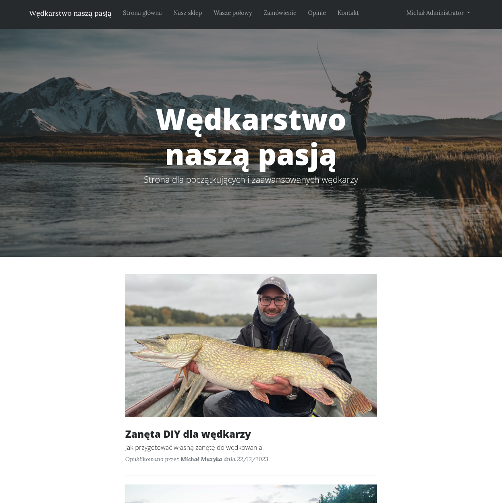
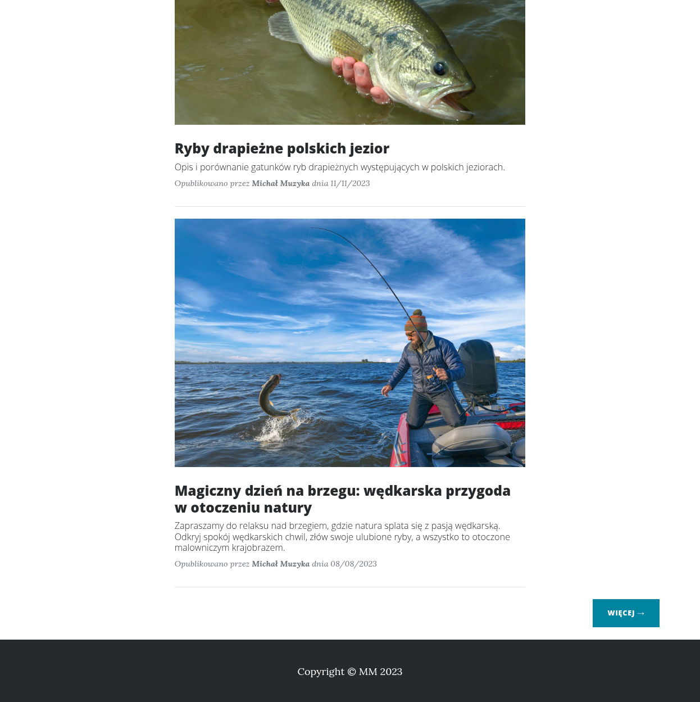
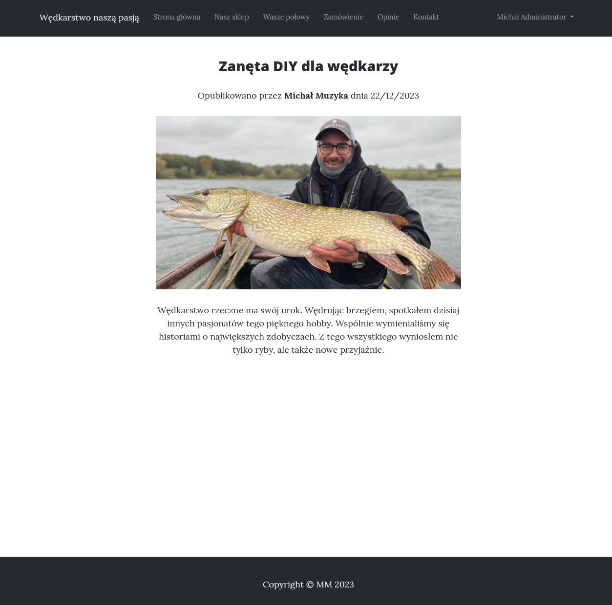
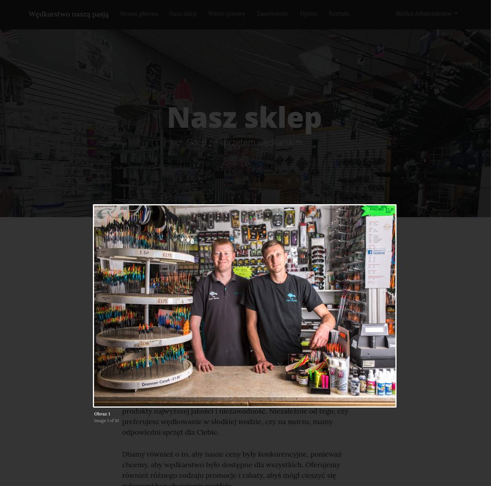
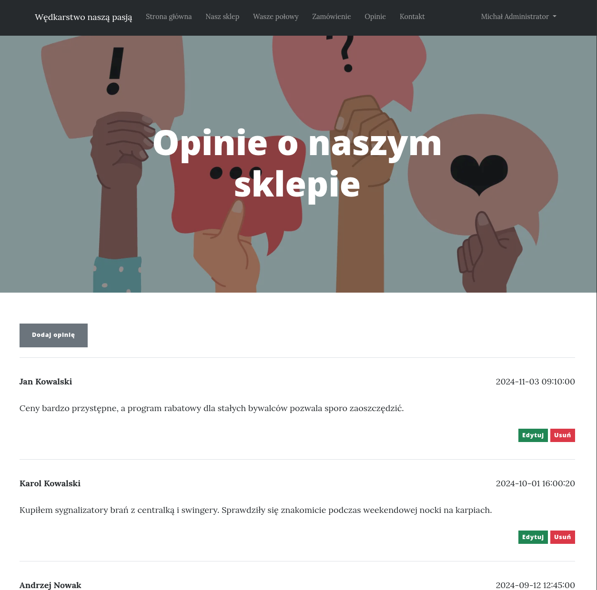
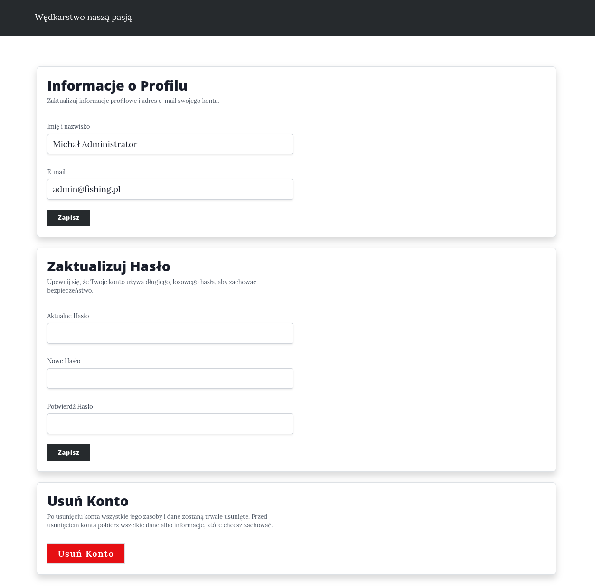
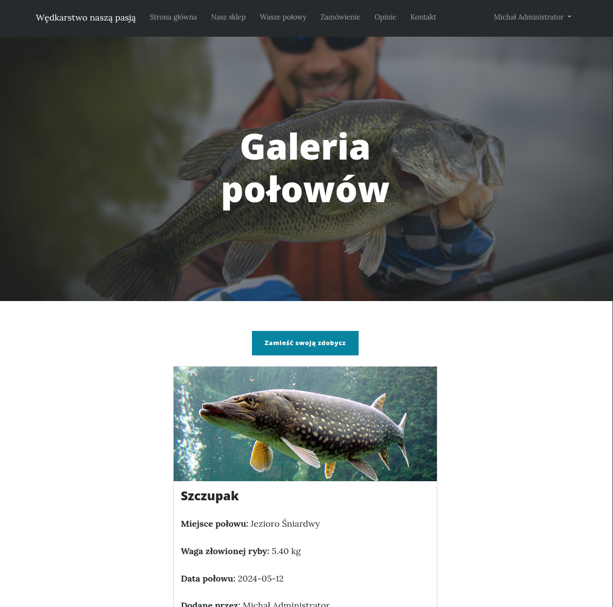
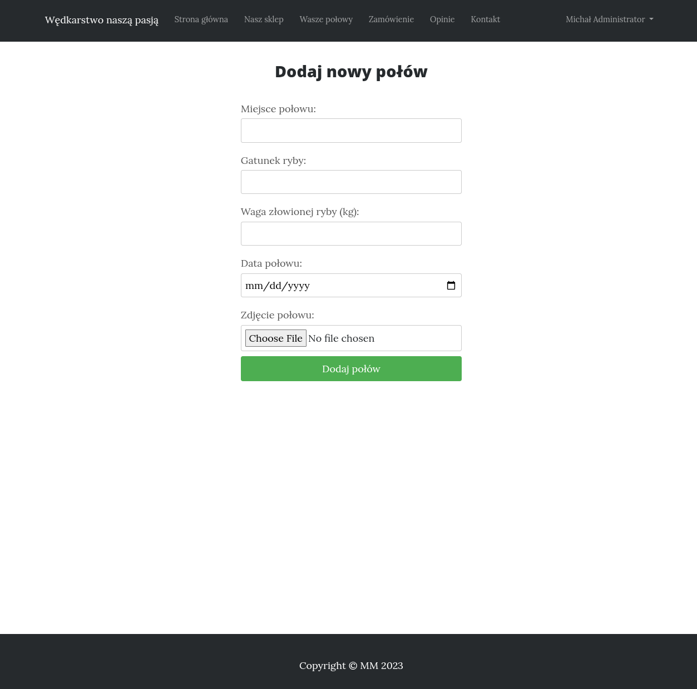
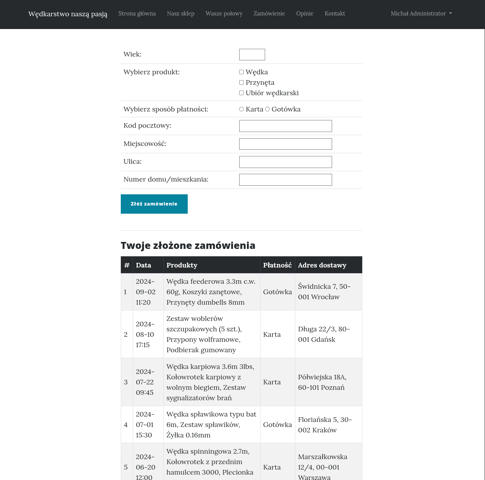
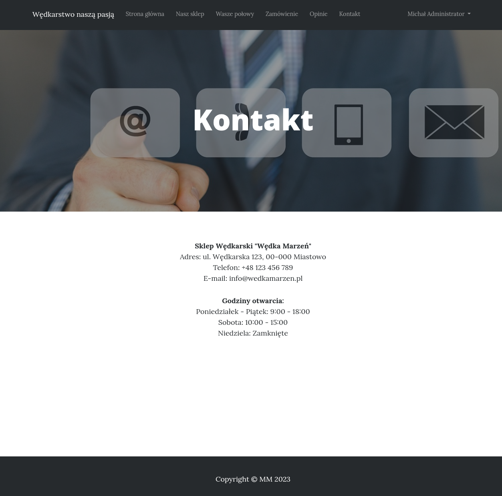

# Fishing Website (Laravel)

A web application and portal for a fishing store.

The portal allows the store to publish various articles about fishing, while customers can share their opinions and reviews. It features a gallery and description showcasing the store, and contact details. Additionally, the application includes a fish catch gallery, custom equipment ordering, and interactive REST API documentation with Swagger UI, built with Laravel, Blade, and MariaDB.

---

## Screenshots

| Home & Blog Overview | Home & Blog Overview |
|:---:|:---:|
|  |  |

| Article Reading View | Shop Showcase & Lightbox Gallery |
|:---:|:---:|
|  |  |

| Customer Reviews & Ratings | User Profile & Authentication |
|:---:|:---:|
|  |  |

| Fish Catch Trophy Gallery | Submit Trophy Catch Form |
|:---:|:---:|
|  |  |

| Custom Equipment Order Form | Store Location & Contact |
|:---:|:---:|
|  |  |

---

## Features

- **Blog & Dynamic Feed:** Reverse chronological fishing articles with an animated header slideshow and asynchronous AJAX "Load More" pagination without page reload.
- **Fish Catch Gallery ("Wasze połowy"):** Community catch showcase where registered anglers share their trophy fish (species, weight, catch location, date, and photograph).
- **Fish Catch Management (CRUD):** Registered users can upload, edit, and delete their catch reports with photo attachment support.
- **Custom Equipment Ordering:** Dedicated order placement system with server-side validation (products, payment method, age, and shipping address).
- **Shop Opinions & Reviews (CRUD):** Customer feedback system where users can submit, browse, edit, and delete store reviews.
- **Role-Based Content Moderation:** Administrators (`admin` status) have full permission to edit or delete any user's fish catch entry or store review across the portal.
- **Interactive REST API & Swagger UI:** Comprehensive REST API covering authentication, posts, catches, reviews, and orders with Sanctum Bearer token authorization.
- **Automatic Database Seeding:** MariaDB is automatically migrated and seeded on startup with realistic users, blog posts, community catches, reviews, and equipment orders.

---

## Tech Stack

- **Backend:** PHP 8.3, Laravel 13, Eloquent ORM, Laravel Sanctum, Laravel Breeze, Swagger UI (OpenAPI 3.0)
- **Frontend:** Blade Templates, Bootstrap 5, Tailwind CSS 4, Alpine.js, jQuery, Lightbox2, Vite 6
- **Database:** MariaDB 10.6
- **Testing:** PHPUnit (Unit & Feature tests), Node.js Test Runner
- **Deployment:** Docker, Docker Compose, Apache, phpMyAdmin

---

## API Documentation (Swagger UI)

The backend provides interactive API documentation powered by **Swagger UI (OpenAPI 3.0)** with full Laravel Sanctum Bearer authorization support.

When running the application (via Docker or locally), the Swagger UI is available at:
👉 **[http://localhost:8000/swagger](http://localhost:8000/swagger)** *(or `http://localhost:8000/api/documentation`)*

An offline OpenAPI 3.0 specification file is also available in the repository at [`docs/swagger.json`](docs/swagger.json).

### Available Endpoints

| Method | Endpoint | Access | Description |
|---|---|---|---|
| `POST` | `/api/register` | Public | Register a new user and receive a Sanctum token |
| `POST` | `/api/login` | Public | Authenticate user and receive a Sanctum Bearer token |
| `POST` | `/api/logout` | Bearer Token | Revoke current authenticated access token |
| `GET` | `/api/user` | Bearer Token | Retrieve authenticated user profile |
| `GET` | `/api/posts` | Public | Retrieve blog posts with pagination (`?skip=0&take=4`) |
| `GET` | `/api/posts/{id}` | Public | Retrieve a specific blog post by ID |
| `GET` | `/api/fishes` | Public | Retrieve all community fish catches |
| `GET` | `/api/fishes/{id}` | Public | Retrieve details of a single fish catch |
| `POST` | `/api/fishes` | Bearer Token | Create a new fish catch entry |
| `PUT` | `/api/fishes/{id}` | Bearer Token | Update an existing fish catch (author or admin) |
| `DELETE` | `/api/fishes/{id}` | Bearer Token | Delete a fish catch entry (author or admin) |
| `GET` | `/api/comments` | Public | Retrieve all customer store reviews |
| `POST` | `/api/comments` | Bearer Token | Submit a new customer review |
| `PUT` | `/api/comments/{id}` | Bearer Token | Update an existing review (author or admin) |
| `DELETE` | `/api/comments/{id}` | Bearer Token | Delete a review (author or admin) |
| `GET` | `/api/orders` | Bearer Token | Retrieve user orders (or all orders for admin) |
| `POST` | `/api/orders` | Bearer Token | Place a new fishing equipment order |

### How to Test Endpoints in Swagger UI

1. Open **[http://localhost:8000/swagger](http://localhost:8000/swagger)** in your browser.
2. Under the **Auth** section, expand `POST /api/login`, click **Try it out**, and submit the demo credentials:
   ```json
   {
     "email": "admin@fishing.pl",
     "password": "Admin123!"
   }
   ```
3. Copy the `token` string from the JSON response body.
4. Click the green **Authorize** button (🔓) located at the top-right of Swagger UI.
5. In the input field (`sanctumAuth`), paste **only** the copied token string (do **not** include the word `Bearer`; Swagger UI automatically adds the `Bearer ` prefix):
   ```text
   <your_copied_token>
   ```
6. Click **Authorize**, then **Close**.
7. You can now execute requests against protected endpoints under **Fishes**, **Comments**, and **Orders** directly from your browser.

---

## Quick Start (Docker)

### Requirements
- [Docker Engine & Docker Compose](https://docs.docker.com/get-docker/)

### 1. Clone the repository
```bash
git clone https://github.com/musmike/fishing-website-laravel.git
cd fishing-website-laravel
```

### 2. Configure environment variables
Copy the example environment file:
```bash
cp .env.example .env
```
*(The container startup script also automatically initializes `.env` from `.env.example` if not already present).*

### 3. Build and start the services
```bash
docker compose up -d --build
```

### 4. Open in browser
- **Web Application:** [http://localhost:8000](http://localhost:8000)
- **Swagger UI:** [http://localhost:8000/swagger](http://localhost:8000/swagger)
- **phpMyAdmin:** [http://localhost:8080](http://localhost:8080)

### Demo Credentials
The database is automatically seeded on startup with realistic demo accounts:
- **Administrator:**
  - **Email:** `admin@fishing.pl` *(or `michal.muzyka2002@gmail.com`)*
  - **Password:** `Admin123!`
- **Standard User:**
  - **Email:** `user@fishing.pl` *(or `elzbieta@wp.pl`, `andrzej@wp.pl`, `karol@wp.pl`)*
  - **Password:** `User123!`

---

## Running Tests

### Backend & API Tests (PHPUnit inside Docker)
```bash
docker compose exec app php artisan test
```
*Runs Laravel PHPUnit Feature and Unit test suites verifying Swagger UI accessibility, OpenAPI 3.0 specification integrity, core blog and gallery routes, guest authorization guards, fish catch management, and REST API endpoints.*

### Architecture & Spec Tests (Node.js Test Runner)
```bash
npm test
```
*Executes automated verification of OpenAPI 3.0 schema, API controllers, database seeder models, and environment settings.*

---

## Architecture & Ports

| Service | Technology | Port (Host) | Description |
|---|---|---|---|
| Web App & API (`app`) | PHP 8.3 / Laravel 13 + Apache | `http://localhost:8000` | Web application & Swagger (`/swagger`) |
| Database (`db`) | MariaDB 10.6 | `localhost:3306` | MariaDB relational database |
| Database UI (`phpmyadmin`) | phpMyAdmin | `http://localhost:8080` | Web-based database management tool |
